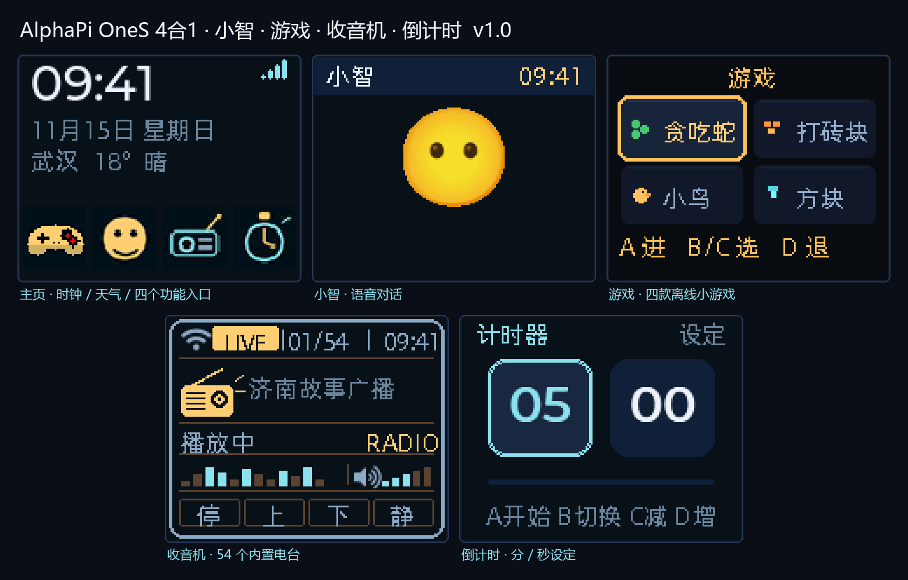

# AlphaPi OneS 4合1 —— 小智 · 游戏 · 收音机 · 倒计时

**版本 1.0**（2026-11-15）· 适用于 **AlphaPi One S**（ESP32-S2R2）

一台 160×128 的小屏桌面设备，四种玩法一键切换：跟小智说话、玩四款小游戏、听网络电台、做倒计时。外加班表主页和手机网页后台。



> 上排：主页 · 小智 · 游戏　下排：收音机 · 倒计时。
> 五屏全部由 v1.0 固件的 **LVGL 页面代码逐像素重放**生成：字体取自 assets 分区的
> `font_puhui_deepseek_14_1.bin` 与 LVGL 内置 Montserrat，图标取自
> `desktop_assets.h` 的 32×32 RGB565 位图，坐标、圆角、配色与 `desktop_ui.h`
> 一一对应。时间、日期、气温为示例数据。

单屏大图：[主页](docs/screen-home.png) ·
[小智](docs/screen-voice.png) ·
[游戏](docs/screen-game.png) ·
[收音机](docs/screen-radio.png) ·
[倒计时](docs/screen-timer.png)

---

## 目录

- [功能一览](#功能一览)
- [硬件要求](#硬件要求)
- [按键与操作](#按键与操作)
- [手机网页设置](#手机网页设置)
- [刷机](#刷机)
- [首次使用流程](#首次使用流程)
- [校验值](#校验值)
- [1.0 版本说明](#10-版本说明)
- [已知限制](#已知限制)
- [从源码编译](#从源码编译)
- [仓库结构](#仓库结构)
- [来源与许可](#来源与许可)

---

## 功能一览

| 功能 | 说明 | 入口 |
|---|---|---|
| **小智语音助手** | 深色动态表情页（64×64 表情动画 + 状态文字），按键唤起对话，云端 ASR → LLM → TTS；状态（待命 / 聆听 / 说话 / 处理中）实时显示 | 主页短按 **B** |
| **网络收音机** | 54 个内置电台（济南、山东、央广、京沪、各省重点台、特色音乐台），支持自定义 MP3 直链、可增可删；播放时按音频实时电平画波形 | 主页短按 **C** |
| **游戏（4 款）** | 贪吃蛇、打砖块、像素鸟、俄罗斯方块，带启动器、计分 HUD、通关判定与音效 | 主页短按 **A** |
| **倒计时** | 1–5999 秒，分钟/秒字段分别调整，结束三声提示音 + 闪烁「时间到」 | 主页短按 **D** |
| **表盘主页** | 大号时间（时:分）、日期星期、城市 / 气温 / 天气、Wi-Fi 信号格，下方四个功能图标 | 开机即是 |
| **手机网页后台** | 连 `AlphaPi-Desk` 热点后打开 `192.168.4.1`：配 Wi-Fi、选天气城市、远程控制收音机、管理自定义电台、查看键位 | 主页长按 **A** |

界面全部为 160×128 手绘矢量界面（自绘字体 + 抗锯齿图形 + 圆角卡片），无外部 UI 依赖，不占额外帧缓冲。

### 小智语音助手

- 基于 [xiaozhi-esp32](https://github.com/78/xiaozhi-esp32) 派生，接入官方服务端。
- 首次使用需要在屏幕上显示的验证码去服务端绑定设备；绑定信息存在设备 NVS 里，换机/擦除后需重新绑定。
- 麦克风采集与扬声器播放共用 N32 音频协处理器（半双工），所以**收音机播放时不能同时对话**，切页时固件会自动让出音频通道。

### 网络收音机

- 内置电台 54 个，按「济南本地 → 山东省内 → 央广/北京/天津 → 上海 → 其他重点省台 → 国际与特色音乐」排序。
- 只支持 **MP3 直链**（`http(s)://…mp3` 这类实时流）；AAC、HLS（`.m3u8`）无法解码。
- 「我的电台」支持多行 `名称|地址`，保存在 NVS，**排在内置电台前面**，进收音机先播第一条；可随时清空。
- 流量约 64 kbps，一首歌大小/小时，Wi-Fi 稳定即可长时间播放；波形按解码后的 PCM 实时电平驱动，静音或缓冲时为平线。
- 音量与静音状态断电记忆。

### 游戏

启动器里四款游戏横排图标（苹果 / 砖块 / 小鸟 / 方块），带最高分与当前分显示。

| 游戏 | 玩法 | 键位 |
|---|---|---|
| **贪吃蛇** | 吃食物变长，撞墙或撞自己结束 | A 上 · B 下 · C 左 · D 右 |
| **打砖块** | 挡板反弹，清空全部砖块进下一关；每关速度+ | A 发球 · B 短按加速（2/3/4 档循环） · C 左移 · D 右移 |
| **像素鸟** | 四键分档拍翅，穿过水管缝隙得分 | A 大跳 · B 中跳 · C 小跳 · D 轻点 |
| **俄罗斯方块** | 消行得分，堆积到顶结束 | A 旋转 · B 硬降 · C 左移 · D 右移 |

游戏内通用长按：**A 长按重开**、**B 长按暂停/继续**、**C 长按回游戏列表**、**D 长按回主页**（打砖块的 B 长按是暂停、C 长按回列表，与上面一致）。

### 倒计时

- 进入即显示上次设定的时长，**A** 开始 / 暂停，**B** 切换「分 / 秒」字段，**C** 减少、**D** 增加，长按 **A** 一键重置。
- 倒计时结束：屏幕闪烁「时间到」，并响三声提示音；**任意键**确认并回到设定值。
- 设定值断电保存。收音机页 / 小智页不会响提示音（半双工，避免打断音频流）。

---

## 硬件要求

| 项目 | 规格 |
|---|---|
| 开发板 | **AlphaPi One S**（本项目实测板） |
| 主控 | ESP32-S2R2，实测芯片 revision 1.0 |
| Flash / PSRAM | 8 MB Flash / 2 MB PSRAM（PSRAM 必需，收音机与界面缓冲都放 PSRAM） |
| 屏幕 | SPI 屏，物理 128×160，横屏 160×128，RGB565（固件按 ST7789 时序初始化） |
| 音频 | N32 UART 协处理器，460800 baud，24 kHz / 8-bit 无符号 / 单声道 |
| 按键 | 前置 A / B / C / D 四键（高电平有效） |
| 无线 | 2.4 GHz Wi-Fi；ESP32-S2 无蓝牙 |

**不适用于 AlphaPi One（ESP32-S3）、ESP32-C3 或其他 GPIO 不同的板子。** 同名不同批次的 One S 也请先核对引脚：

| 接口 | GPIO |
|---|---|
| 屏幕 SCK / MOSI / MISO | 37 / 38 / 45 |
| 屏幕 CS / DC / RESET / 背光 | 34 / 36 / 35 / 33 |
| 音频 UART1 TX / RX | 3 / 0 |
| 按键 A / B / C / D | 13 / 12 / 11 / 10（高电平有效） |

---

## 按键与操作

手势约定（全机统一）：

- **单击** = 当前页的主要动作；
- **双击**（仅主页）= 直接进入该功能并自动开始，省一次确认；
- **长按**（约 0.65 秒，游戏页 0.9 秒）= 第二功能或被长按表定义的动作。

### 主页（表盘）

| 按键 | 单击 | 长按 |
|---|---|---|
| A | 进入 **游戏** | 打开 **配网页**（热点开关、清除已存 Wi-Fi） |
| B | 进入 **小智** | 音量 − |
| C | 进入 **收音机** | 音量 + |
| D | 进入 **倒计时** | — |

主页双击 A/B/C/D：直接切到对应功能并自动开始（游戏进第一关、小智直接开麦、收音机直接播放、倒计时直接开始跑）。

### 小智页

| 按键 | 单击 | 长按 |
|---|---|---|
| A | 开始 / 结束这一轮对话 | 强制结束对话 |
| B | 音量 − | 音量 − |
| C | 音量 + | 音量 + |
| D | — | 回主页 |

### 游戏页

启动器：A 进入所选游戏 · B 上一个 · C 下一个 · D 回主页（长按 D 同样回主页）。
游戏内键位见上文[游戏](#游戏)表格。

### 收音机页

| 按键 | 单击 | 长按 |
|---|---|---|
| A | 播放 / 暂停 | 打开 **电台列表** |
| B | 上一台 | 音量 − |
| C | 下一台 | 音量 + |
| D | 静音 / 恢复 | 回主页 |

电台列表内：A 播放选中台并关闭列表 · B 上移 · C 下移 · D 关闭列表（长按 D 关闭）。

### 倒计时页

| 按键 | 单击 | 长按 |
|---|---|---|
| A | 开始 / 暂停 | 重置为设定值 |
| B | 切换编辑字段（分 / 秒） | 音量 − |
| C | 减少（分或秒） | 音量 + |
| D | 增加（分或秒） | 回主页 |

结束后任意键确认。

### 配网页（主页长按 A 进入）

| 按键 | 单击 | 长按 |
|---|---|---|
| A | 开 / 关热点 | — |
| B | — | **清除已保存的 Wi-Fi**（旧网连不上时用） |
| D | — | 回主页 |

---

## 手机网页设置

1. 主页长按 **A** 进入配网页，短按 **A** 打开热点。
2. 手机 Wi-Fi 里连 **`AlphaPi-Desk`**（当前版本**无密码**），浏览器打开 **`http://192.168.4.1`**（没自动跳转就手动输入）。
3. 四个标签页：

| 标签 | 能做什么 |
|---|---|
| **天气** | 搜索城市 → 选中 → 同步到设备；桌面城市名与天气一起更新（时间固定北京时间） |
| **Wi-Fi** | 扫描附近网络或手动填写 SSID/密码，保存后设备自动连接；**只支持 2.4 GHz**，不支持 5 GHz 专用网络 |
| **收音机** | 远程上一台 / 播放暂停 / 下一台 / 停止、音量滑杆、查看当前台地址；「我的电台」一行一条 `名称|地址`，可保存可清空 |
| **按键** | 四键在各页面的键位说明 |

热点开着不影响已连的家用 Wi-Fi；用完可以关掉（配网页短按 A）。

> 公开版不含任何人的 Wi-Fi 名称/密码、设备 NVS 或小智绑定资料，首次使用请自行配网。热点无密码，建议只在配网时开启。

---

## 刷机

### 需要准备的

- 一根能传数据的 USB 线（有些线只供电）；
- Windows / macOS / Linux 电脑；
- 本仓库 `firmware/v1.0/` 下的文件。

**进刷机模式**：USB 连接电脑 → 电源开关拨到关 → **按住 BOOT 键** → 开机 → 等 2 秒松开 BOOT。

### 方式一：网页刷机（推荐，免装工具）

1. 用 **Chrome / Edge**（需支持 WebSerial）打开 `firmware/v1.0/alphapi-one-s-web-flasher.html`；
2. 点「连接」选串口；
3. 按提示刷写。全程约 1–2 分钟，页面会显示每一段进度。

也可以双击 `firmware/v1.0/start-web-flasher.cmd` 起本地服务再打开页面。

### 方式二：命令行脚本

```bat
:: 在 firmware\v1.0\ 目录下双击，或命令行运行
flash.cmd
:: 按提示输入串口号（例如 COM17）
```

脚本本质是调用 esptool（`flash_cli.py` 会自动定位/调用），参数已按五段地址写好。

### 方式三：完整固件一次性刷（最简单）

```bash
esptool.py --chip esp32s2 --port COM17 write_flash 0x0 AlphaPi-OneS-4in1-v1.0-full-8MB.bin
```

`AlphaPi-OneS-4in1-v1.0-full-8MB.bin` 已经把五段按地址拼好，适合救砖/整片重刷。

### 五段地址对照（精细刷写 / 只刷某一段时用）

| 地址 | 文件 | 大小 (B) | 说明 |
|---|---|---|---|
| `0x1000` | `bootloader.bin` | 16,080 | 二级引导 |
| `0x8000` | `partition-table.bin` | 3,072 | 分区表 |
| `0xD000` | `ota_data_initial.bin` | 8,192 | OTA 标记（清空选择） |
| `0x20000` | `AlphaPi-OneS-Desktop-Dark.bin` | 2,692,944 | 应用固件（app 分区 5 MB） |
| `0x500000` | `assets.bin` | 1,865,367 | 资源包：中文普惠体字库 + 21 个表情（2 MB 分区） |

完整命令：

```bash
esptool.py --chip esp32s2 --port COM17 --baud 921600 write_flash \
  --flash_mode dio --flash_freq 80m --flash_size 8MB \
  0x1000 bootloader.bin \
  0x8000 partition-table.bin \
  0xd000 ota_data_initial.bin \
  0x20000 AlphaPi-OneS-Desktop-Dark.bin \
  0x500000 assets.bin
```

**注意**

- **`assets.bin` 首次刷机必须带**，否则没有中文字库与表情，界面会出现空白方块。
- 不写 `0x9000`（NVS），所以升级固件**一般保留**原有配网与小智绑定；想彻底重来请在配网页长按 B 清 Wi-Fi，或用 `esptool erase_flash` 整片擦除。
- **刷完别忘关机重启**：松开所有按键，电源开关关 3–5 秒再开。设备有电池，只拔 USB 不一定会重启。

---

## 首次使用流程

1. 刷完开机 → 进入表盘主页（时间会先显示 `--:--`，联网校时后正常）。
2. 主页**长按 A** → 配网页 → **短按 A** 打开热点。
3. 手机连 `AlphaPi-Desk` → 打开 `192.168.4.1` → **Wi-Fi** 标签填家里 2.4 GHz 网络 → 保存并连接。
4. 连接成功后：**天气** 标签搜索城市并同步；桌面日期、星期、城市与气温开始正常刷新。
5. 小智：主页短按 **B**，按屏幕验证码在服务端绑定设备；绑定后短按 **A** 说话。
6. 收音机：主页短按 **C**，短按 **A** 播放（想听自己的台：网页「我的电台」加一行 `名称|地址`）。
7. 游戏 / 倒计时：主页短按 **A** / **D** 直接玩。

---

## 校验值

**应用固件** `firmware/v1.0/AlphaPi-OneS-Desktop-Dark.bin`
`2,692,944 B` · md5 `b16688411c68e57becaab9ef89d975e6`

**完整固件** `firmware/v1.0/AlphaPi-OneS-4in1-v1.0-full-8MB.bin`
`7,108,247 B` · md5 `df58579d076342ee857233e6b6f27575`

五段各自 md5 见 `firmware/v1.0/md5sums.txt`：

| 文件 | md5 |
|---|---|
| `AlphaPi-OneS-Desktop-Dark.bin` | `b16688411c68e57becaab9ef89d975e6` |
| `bootloader.bin` | `6bbe215da33a337498bf277493618a88` |
| `partition-table.bin` | `6010f63a2f1b62a0a7229304d80cd03c` |
| `ota_data_initial.bin` | `84d04c9d6cc8ef35bf825d51a5277699` |
| `assets.bin` | `c23298d3f2ec5a67022336ba07be9a80` |

---

## 1.0 版本说明

1.0 是本项目第一个公开发布版本，内容等于内部迭代 v37。相对上一轮（v36）修的三个实机问题：

### 一、游戏 / 倒计时没有声音、结束时有喇叭异响

三条独立原因，各自对应一个现象：

1. **异响 = 重复发 WAV 头。** 每条音效都重新握手会让 44 字节 RIFF 头被 N32 当成 PCM 播出去，听起来就是「结束时有声音但像喇叭异响」。现在只在流间隙 > 400 ms 或链路已断时才重发头。
2. **听不见 = 幅度太小。** 音效幅度 9000 → 20000（8-bit 下约 −4 dBFS），小喇叭上才听得清。
3. **来不及开播 = 音效太短。** 触发音最短 83 ms，前加 20 ms 静音预热、后加 150 ms 静音尾，5 ms 淡入淡出。
4. 握手顺序改回「音量 → 停录音 → WAV 头」，避免音频通路复位后被吞掉。

### 二、小智识别不灵敏、会卡死

- UART 读改**总预算超时**：原来字节断续到达时一次「50 ms 事务」能拖到几百毫秒并全程握着 UART 锁，这是卡死的直接来源。
- 麦克风一次读满 **200 字节**（原 160），读失败统一清缓冲并重开录音，不再让半帧残留把后续每次读都变成校验失败——识别「不灵敏」的主要来源。
- 采集装配上限 200 ms → 80 ms。

### 三、切页不再无上限等待

进收音机 / 小智页等待旧音频链路退出时加了 **4 秒硬超时**，极端情况下页面也不会永久停在「正在切换」。

详细逐条记录见 [CHANGELOG.md](CHANGELOG.md)。

---

## 已知限制

- **只支持 2.4 GHz Wi-Fi**，无蓝牙；不读电量与充电状态。
- **音频半双工**：收音机与小智不能同时出声；收音机播放时游戏音效静默。
- 收音机只支持 **MP3 直链**，AAC / HLS 播放不了。
- 屏幕控制器批次可能是 ST7735 / ST7789，若出现反色、错位需改 `st7789.cc` 的初始化序列。
- 小智依赖服务端，网络差时可能要多试一次；长对话的稳定性受服务端影响。
- 160×128 屏幕空间有限，长文本会截断显示（例：收音机页 LIVE 药丸里文字底部约 1px 被父容器裁掉）。
- 五段刷机漏掉 `assets.bin` 会导致中文显示为方块。
- 各功能页切换时会等音频链路退出（最长 4 秒），这段时间屏幕提示「正在切换」。

---

## 从源码编译

实测环境：**ESP-IDF 6.0.2**，目标 `esp32s2`。需要 2 MB PSRAM 的板子。

```bash
# 在 ESP-IDF 环境终端里，源码根目录执行
idf.py -B build -D IDF_TARGET=esp32s2 \
  -D "SDKCONFIG_DEFAULTS=previous.defaults;ones.defaults" build
```

- 首次编译需要联网拉依赖（`idf.py` 自动处理），保留 `source/` 包里的 `dependencies.lock` 以固定版本。
- 板级代码在 `main/boards/alphapi-one-s-desktop/`，`main/CMakeLists.txt` 已固定选这块板，不要用上游多板脚本切换型号。
- 当前占用：app 2,692,944 B / app 分区 5 MB（约 53%，余量 47%）。

源码包：`source/AlphaPi-OneS-4in1-source-v1.0.zip`（不含 `build/`、`managed_components/` 等生成物，约 20 MB）。

---

## 仓库结构

```
AlphaPi-OneS-4in1/
├── README.md                  # 本文件
├── CHANGELOG.md               # 版本与改动记录
├── LICENSE                    # MIT（继承上游）
├── THIRD_PARTY_NOTICES.md     # 第三方组件声明
├── docs/
│   ├── desktop-preview.png    # 五屏总览（由固件绘制代码逐像素重放）
│   ├── screen-home.png        # 主页单屏
│   ├── screen-voice.png       # 小智单屏
│   ├── screen-game.png        # 游戏列表单屏
│   ├── screen-radio.png       # 收音机单屏
│   └── screen-timer.png       # 倒计时单屏
├── firmware/v1.0/
│   ├── AlphaPi-OneS-Desktop-Dark.bin      # 应用固件（写 0x20000）
│   ├── bootloader.bin                     # 写 0x1000
│   ├── partition-table.bin                # 写 0x8000
│   ├── ota_data_initial.bin               # 写 0xD000
│   ├── assets.bin                         # 写 0x500000（字库 + 表情）
│   ├── AlphaPi-OneS-4in1-v1.0-full-8MB.bin # 完整固件（写 0x0）
│   ├── alphapi-one-s-web-flasher.html     # 网页刷机器
│   ├── start-web-flasher.cmd              # 起本地服务打开网页刷机
│   ├── flash.cmd / flash_cli.cmd / flash_cli.py
│   ├── flash_args.txt                     # esptool 参数
│   └── md5sums.txt
└── source/
    └── AlphaPi-OneS-4in1-source-v1.0.zip  # 完整工程源码
```

---

## 来源与许可

- 小智基础工程：[78/xiaozhi-esp32](https://github.com/78/xiaozhi-esp32)，保留原项目 LICENSE 与版权声明（MIT）。
- 收音机与板级适配参考 AlphaPi-Radio 独立版实现，其单独授权未确认，见 [THIRD_PARTY_NOTICES.md](THIRD_PARTY_NOTICES.md)。
- `components/desktop_transport` 保留原来源代码与 LICENSE。

根目录 MIT 许可**不覆盖**第三方资源（字库、表情、音频解码库等），各自许可见源码包内对应目录。请勿把个人 Wi-Fi 凭据、NVS 转储、小智绑定信息提交到仓库。

固件按现状提供，刷机与使用风险自负。
